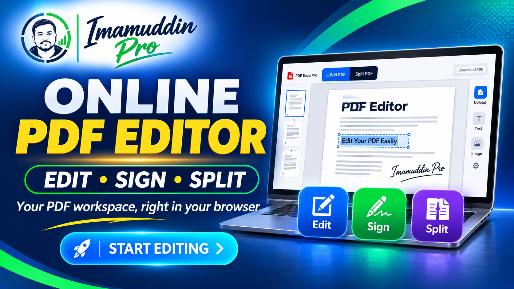
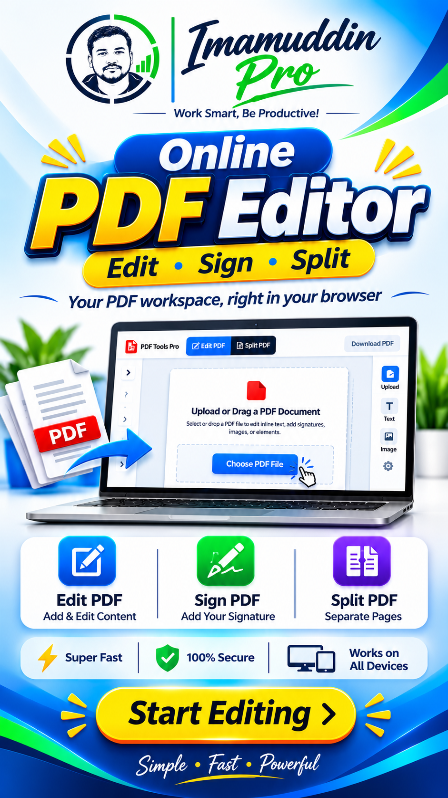

# PDF Tools Pro

### A free online PDF editor, splitter, and merger — by Imamuddin Pro

<p align="center">
  <a href="https://imamuddinpro.blogspot.com/p/free-online-pdf-editor-edit-split-join.html">
    
  </a>
</p>

<p align="center">
  <strong>Edit PDFs · Add text and signatures · Split pages · Join and merge files</strong>
  <br>
  <strong>100% free to use · No subscriptions · No usage fees · No premium tier</strong>
</p>

PDF Tools Pro is a browser-based PDF workspace for everyday document tasks. It brings **Edit PDF**, **Split PDF**, and **Join PDF** into one responsive interface—so you can make practical changes, extract pages, or combine documents without installing a desktop application.

It is a free alternative for common PDF workflows often handled by paid tools such as Adobe Acrobat Pro and Nitro PDF Pro. It is not intended to reproduce every advanced feature of those full desktop products.

> **Free means free:** There is no charge, subscription, per-file fee, per-page fee, or premium plan. Split and join/merge workflows have no built-in usage quota. The practical size and workload you can handle depend on your browser, available device memory, and the PDF files themselves.

**Live tool:** [Open PDF Tools Pro](https://imamuddinpro.blogspot.com/p/free-online-pdf-editor-edit-split-join.html)

---

## At a glance

| | What you can do |
|---|---|
| **Edit PDF** | Edit detected text, add text boxes and images, insert a signature image, rotate pages, zoom, and add Whiteout covers. |
| **Split PDF** | Select the pages you need and download them as individual PDF files in a ZIP archive—or combine the selected pages into one PDF. |
| **Join PDF** | Add multiple PDFs, arrange individual pages in your preferred order, remove unwanted pages, and export one merged PDF. |
| **Font handling** | Attempts to retain the PDF's existing font when editing text by reusing available embedded font data and matching compatible fonts where possible. |
| **Cost** | 100% free to use, with no paid plan, subscription, or built-in usage quota. |

## Features

### 1. Edit PDF

- Open a PDF from your device or use the available drag-and-drop area.
- Navigate pages, jump to a page number, and zoom in or out.
- Rotate the active page left or right in 90-degree steps.
- Edit text recognized in the PDF text layer.
- Add movable and resizable text boxes.
- Insert images, including a handwritten signature image (PNG, JPEG, or WebP).
- Add Whiteout rectangles, choose a cover colour, and move, resize, duplicate, or remove editing elements.
- Download the edited document as a new PDF.

### 2. Split PDF

- Preview PDF pages as thumbnails.
- Select individual pages or use **Select All**, **Clear**, and **Invert** controls.
- Export selected pages as separate PDF files inside one ZIP archive.
- Alternatively, combine the selected pages into a single PDF file.
- Review your selection before exporting.

### 3. Join / Merge PDF

- Add two or more PDF files to one workspace.
- View every imported page as an individual thumbnail.
- Identify pages by their source PDF and original page number.
- Drag and drop pages to change the final sequence.
- Use first, up, down, and last controls for precise ordering.
- Remove individual pages that should not appear in the result.
- Export the arranged pages as one combined PDF document.

### Font preservation

PDF Tools Pro is designed to keep edited text visually consistent with the source document wherever the PDF provides usable font information. When possible, it reuses font data embedded in the original PDF and checks character coverage. It can also look for a compatible font when the original cannot be reused.

**Please note:** Exact font preservation cannot be guaranteed for every PDF. Some documents use subsetted, uncommon, restricted, or unavailable fonts, and some fonts do not contain every character. In those cases, a compatible fallback may be used. Always review the exported document—especially when exact typography is important.

---

## Visual preview

<p align="center">
  
</p>

<p align="center">
  <em>One browser-based workspace for practical PDF editing and page management.</em>
</p>

---

## How to use

### Edit a PDF

1. Open **Edit PDF** and choose a PDF file.
2. Navigate to the page you want to work on.
3. Select the text, image, signature, rotation, or Whiteout tool you need.
4. Position and review your changes.
5. Choose **Download PDF** to save the edited document.

### Split a PDF

1. Open **Split PDF** and select a document.
2. Select the pages you want to extract.
3. Choose the ZIP export to save separate page PDFs, or use the PDF combine option to create one file from the selected pages.
4. Open the downloaded result and check the pages.

### Join or merge PDFs

1. Open **Join PDF** and add at least two PDF files.
2. Review the page thumbnails from all source documents.
3. Drag pages or use the position controls to arrange them.
4. Remove any page you do not need.
5. Select the merge/download control to export one PDF.

---

## Free to use — no limits imposed by a paid plan

PDF Tools Pro is provided for everyone to use without payment.

- **No charge:** Editing, splitting, and joining are available without a fee.
- **No subscription:** There is no monthly or annual subscription.
- **No premium tier:** Core tool features are not locked behind an upgrade.
- **No built-in usage quota:** Split and join/merge operations can be used as often as needed.

The app does not impose a paid-plan file or page allowance. However, very large or complex documents can still be limited by the memory and processing capacity of the device and browser. This is a technical constraint, not a paid usage tier.

---

## Privacy and file handling

The supplied application reads selected PDF files through browser file APIs and performs its PDF processing in the browser. This project does not include a PDF upload endpoint or a server-side PDF-processing service for storing or processing your documents.

The page does load third-party libraries and may request compatible font resources from public CDNs. Those network requests are separate from uploading the PDF document to a PDF-processing server. Use the tool only with documents you are permitted to process, and avoid using public or shared devices for sensitive files.

---

## Project structure

Keep the files in this layout when running or deploying the project:

```text
PDF-Tools-Pro/
├── README.md
├── index.html
├── styles.css
├── app.js
└── assets/
    ├── PDF-Editor-Free-Online-imamuddinpro.png
    └── Free-PDF-Editor-Online-EDIT-SPLIT-JOIN-MERGE-PDF-imamuddinpro.png
```

| File | Purpose |
|---|---|
| `index.html` | HTML5 document, metadata, and PDF tool interface. |
| `styles.css` | Interface styling, layout, and responsive behaviour. |
| `app.js` | PDF editing, splitting, joining, font handling, and dependency loaders. |
| `assets/` | Repository images used in this README. |

---

## Run locally

### Requirements

- A current version of Chrome, Edge, Firefox, or Safari.
- An internet connection to load the external PDF libraries and any required font resources.
- A local HTTP server. No build system or package installation is required for the supplied static files.

### 1. Clone the repository

```bash
git clone https://github.com/YOUR-USERNAME/YOUR-REPOSITORY.git
cd YOUR-REPOSITORY
```

Replace the placeholders with your GitHub username and repository name.

### 2. Start a local server

With Python installed:

```bash
python -m http.server 8000
```

Then open [http://localhost:8000](http://localhost:8000) in your browser.

The project uses relative paths for `styles.css` and `app.js`; keep those files alongside `index.html` unless you also update the references.

---

## Third-party libraries

The application loads the following pinned library versions on demand from [jsDelivr](https://www.jsdelivr.com/):

| Library | Version in source | Purpose |
|---|---:|---|
| [PDF.js](https://github.com/mozilla/pdf.js) | `6.4.299` | Reads and renders PDF pages. |
| [pdf-lib](https://github.com/Hopding/pdf-lib) | `1.17.1` | Creates, modifies, copies, and exports PDF files. |
| [JSZip](https://github.com/Stuk/jszip) | `3.10.2` | Packages separately extracted pages into a ZIP archive. |
| [@pdf-lib/fontkit](https://github.com/Hopding/fontkit) | `1.1.1` | Supports font parsing and embedding when available. |

These dependencies are loaded by the application; you do not need to install them manually. An internet connection is required when the libraries or optional font resources are not already available in the browser session.

---

## Browser support

The interface is responsive and is intended for current desktop and mobile versions of **Chrome, Microsoft Edge, Firefox, and Safari**. For best results, use an up-to-date browser and a device with sufficient available memory, especially when working with large PDFs or many pages.

---

## Important notes and limitations

- **Whiteout is not secure redaction.** It places a visible cover over page content. Do not use it to permanently remove confidential information or assume that covered content has been irreversibly erased. Use a dedicated redaction workflow for sensitive documents.
- **Scanned PDFs:** A scanned page is usually an image. The tool can add text or images over it, but it does not provide OCR to recognize and edit the original scanned words.
- **Font matching:** Original-font retention is best-effort and depends on the PDF's embedded font data and character coverage. Review the exported file when typography matters.
- **Protected PDFs:** Password-protected or encrypted documents may not be supported. Use only files you are authorized to access and edit.
- **Large documents:** Processing happens in the browser, so memory, device performance, browser limits, and document complexity can affect processing time or success.
- **Downloads:** Some browsers may block automatic downloads. Use the fallback download link shown by the app when available.
- **Internet connection:** The PDF libraries and optional font resources are loaded from public CDNs.

---

## Deploy

### GitHub Pages

1. Push the project files and the complete `assets/` folder to your repository.
2. Open the repository's **Settings → Pages**.
3. Under **Build and deployment**, choose deployment from a branch.
4. Select your publishing branch and the repository root (`/`).
5. Save and open the published Pages URL after deployment completes.

Because this is a static front-end project, a build step is not required for the supplied files.

### Other static hosting

Upload `index.html`, `styles.css`, `app.js`, and the `assets/` folder while preserving their relative paths. Serve the files over HTTPS where possible.

---

## Troubleshooting

| Issue | What to check |
|---|---|
| The editor does not load | Confirm the three application files are present and that the CSS/JS paths are correct. Check the browser console for errors. |
| PDF preview is blank | Check the internet connection, CDN access, and PDF.js worker loading. Try a valid, unencrypted PDF. |
| Font appearance changes | The original font may not be embedded or may not contain the required characters. Review the font-preservation notes above. |
| Download does not start | Check browser download permissions and use the fallback link if displayed. |
| A large document fails | Try fewer pages or a smaller file, and close other memory-intensive tabs. |

---

## Contributing and feedback

Suggestions, bug reports, and improvements are welcome. When reporting an issue, include your browser and operating system, the affected workspace, the steps to reproduce the problem, and any relevant console errors.

Do not upload private, confidential, or personally identifiable PDF documents to public issue trackers. Share a sample file only when you have permission and it contains no sensitive information.

---

## License

No project license is currently included. Until a license is added, do not assume that this repository's source code may be reused, redistributed, or modified. Third-party dependencies remain subject to their own licenses; consult their respective repositories for details.

---

## About the project

**PDF Tools Pro** is published by **[Imamuddin Pro](https://imamuddinpro.blogspot.com/)** as a practical, free resource for everyday PDF tasks.

- **Live tool:** [Free Online PDF Editor, Splitter & Merger](https://imamuddinpro.blogspot.com/p/free-online-pdf-editor-edit-split-join.html)
- **Publisher:** [Imamuddin Pro](https://imamuddinpro.blogspot.com/)

> Make everyday PDF work simpler: edit what you need, keep the pages you want, and bring documents together—all in one free browser-based workspace.

*PDF Tools Pro is an independent project and is not affiliated with, endorsed by, or sponsored by Adobe or Nitro.*
